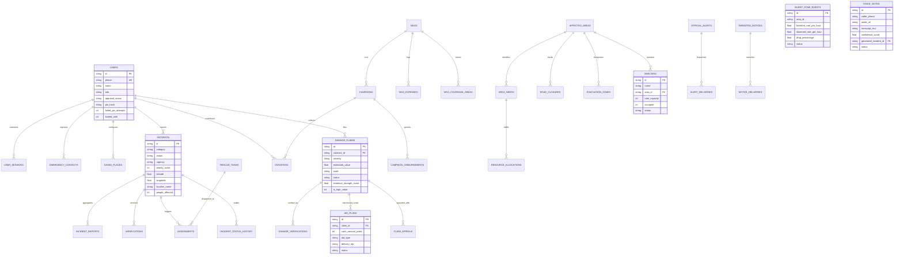

# ResQAI Architecture & Data Model (PRD v2.0)

## 1. High-Level System Architecture

```mermaid
flowchart TD
    subgraph Clients["Clients & Field Ingestion Channels"]
        CIT["Citizen Mobile / PWA<br/>(SOS Wizard, Damage Claims, Status Tracking)"]
        VOL["Volunteer Mobile Console<br/>(Help Board, Field Verification, Impact)"]
        NGO["NGO Console & Explorer<br/>(Needs Claiming, Expense Logging, Ledgers)"]
        GOV["Government Command Center<br/>(District Oversight, Broadcasts, SDRF Accounting)"]
        SMS["SMS & WhatsApp Gateway<br/>(160-Char Low-Bandwidth Inbound Reports)"]
        VOICE["112 Voice Note Ingestion<br/>(Hindi/Regional STT & Raw Audio Archival)"]
    end

    subgraph Gateway["API Gateway & Middleware Layer"]
        CORS["CORS & Rate Limiter"]
        AUTH["Argon2id + JWT + Rotating Refresh Tokens<br/>(30-Day Session, 4-Digit PIN, 5-Attempt Lockout)"]
        RBAC["Role-Based Access Control (RBAC)<br/>(Citizen, Volunteer, NGO, Govt, Master Admin)"]
        DPDP["DPDP Privacy Minimization Filter<br/>(Masking <5 Counts, Strict Reference IDs)"]
    end

    subgraph CoreServices["ResQAI Application Services (Node.js / Express / TypeScript)"]
        INC_SRV["Incident Triage & Idempotent Ingestion Engine"]
        VERIF_SRV["Multi-Tier Verification Service<br/>(Community Verified / Officially Verified)"]
        PRIO_ENG["Deterministic Priority Score & What-If Engine"]
        DISP_SRV["Dispatch & Safe Routing Engine<br/>(Route Caution: 'NOT VERIFIED SAFE')"]
        FLOOD_ML["Flood Early Warning & Calibration Service<br/>(Platt Calibration, SHAP Attribution, 3.5σ Anomaly Guard)"]
        SZ_SRV["Silent-Zone Blackout Detector<br/>(>75% Drop Flagged as Blackout, Never Safe)"]
        SITREP_SRV["Relational Fact Synthesizer<br/>(Zero Synthetic Hallucinations)"]
        FIN_SRV["Double-Entry Ledger & Anti-Duplication Locking<br/>(Integer Paise Math, Razorpay Idempotency)"]
        GOV_SRV["Connect-and-Inform & Watch Panel<br/>(Targeted Role-Filtered Broadcasts)"]
    end

    subgraph DataStore["Persistence & Storage Engine"]
        SQLITE[("SQLite Database in WAL Mode<br/>(Full Foreign Keys, Strict Constraints)")]
        AUDIT[("Tamper-Evident SHA-256 Hash Chain Audit Logs")]
        MEDIA[("Static Audio & Photo Evidence Store")]
    end

    Clients --> Gateway
    Gateway --> CoreServices
    CoreServices --> DataStore
```

---

## 2. Entity-Relationship (ER) Diagram

---

## 3. Core Architectural Guardrails

1. **Human-in-the-Loop Imperative:** AI algorithms only score, classify, and surface potential duplicates or blackouts. Named authorized humans make all triage dispatch, verification, entitlement sanctions, and payout decisions.
2. **DPDP Compliance & Data Minimization:** Public statistics aggregate counts $< 5$ as "fewer than 5". Reference IDs are randomized without exposing citizen phone numbers or full home addresses.
3. **Integer Arithmetic:** All monetary transactions (donations, SDRF grants, damage payouts) are computed and stored as integer paise to eliminate floating-point rounding errors.
4. **Idempotency Everywhere:** Payment webhooks, incident submissions, and SMS gateways employ strict de-duplication locks to guarantee at-most-once processing.

